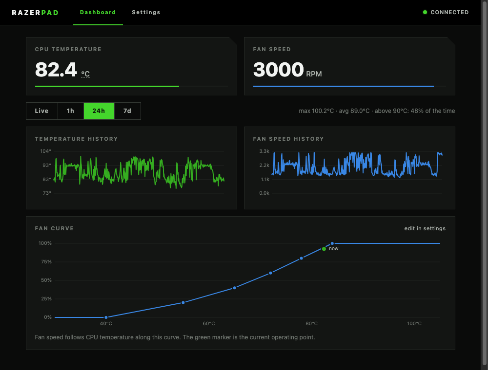
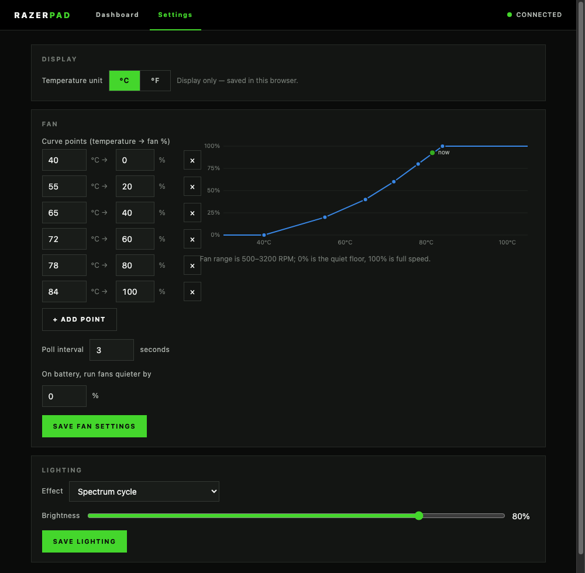

# razerpad-mac

[](https://github.com/ehog/razerpad-mac/actions/workflows/build.yml)

Automatic fan-speed regulation **and Chroma lighting control** for the
**Razer Laptop Cooling Pad** on macOS and Linux (see [Linux](#linux)). Replicates what Razer Synapse does on
Windows: reads the CPU die temperature and continuously adjusts the pad's fan
speed along a fan curve. Includes a local web dashboard and a menu bar app.

Highlights:

- Fan curve with hysteresis, hot-plug recovery, sleep/wake handling
  (releases the pad on sleep so it doesn't spin all night)
- Chroma lighting: static / spectrum / wave / breathing / **reactive**
  (color tracks CPU temperature, green → red)
- Quieter-on-battery option and Auto / Quiet / Max-cool override modes
- Web dashboard (Razer-styled, localhost-only) with live charts,
  persistent thermal history (1h/24h/7d + stats), curve editor, °C/°F
- Menu bar readout with a fan mode switcher



<details>
<summary>Settings page</summary>


</details>

Single dependency-free C binary using IOKit:

- **CPU temperature** — read from the SMC (`TC0P`/`TC0D`/per-core keys; the
  hottest sane reading wins).
- **Fan control** — 90-byte HID feature reports to the pad
  (VID `0x1532`, PID `0x0F43`). Protocol reverse-engineered by
  [FanControl.RazerCoolingPadPlugin](https://github.com/Benson5650/FanControl.RazerCoolingPadPlugin)
  and [razer-coolingpad-linux](https://github.com/Nox1con/razer-coolingpad-linux).

Range is 500–3200 RPM in 50 RPM steps. The pad has no tachometer — the RPM it
reports back is the last commanded value. On exit (or `-o`) control is released
back to the pad's own firmware.

## Requirements

- An Intel Mac (the temperature path reads the Intel SMC; see Notes)
- Xcode Command Line Tools (`xcode-select --install`)
- The Razer Laptop Cooling Pad (RC21-0230, USB VID `0x1532` PID `0x0F43`)
- Python 3 (ships with macOS) for the optional web dashboard

## Build & install

```sh
make            # build ./razerpad
make install    # copy to /usr/local/bin
make agent      # install + start the launchd login agent (auto-run)
make unagent    # stop and remove the login agent
make bar        # build + start the menu bar app (razerpadbar)
make unbar      # stop and remove the menu bar app
```

Or via Homebrew:

```sh
brew install ehog/tap/razerpad
brew services start razerpad     # run the fan-curve daemon at login
```

(The dashboard and menu bar app are set up from a git checkout with
`make dashboard` / `make bar`.)

The agent (`com.razerpad.fancurve`) runs at login, survives pad hot-plugging,
and logs to `/tmp/razerpad.log`.

## Usage

```sh
razerpad            # run the fan-curve loop in the foreground
razerpad -t         # print CPU temperature
razerpad -r         # print the pad's current commanded RPM
razerpad -s 2000    # set a fixed RPM and exit
razerpad -o         # release fan control back to the pad
razerpad -v -i 2    # verbose loop, 2 s poll interval
razerpad -C "40:0,55:30,70:60,85:100"   # custom curve (°C:percent pairs)

# Lighting (standard Chroma extended-matrix protocol, class 0x0F,
# transaction 0x02 / LED id 0x00 — probed and confirmed on this pad):
razerpad -L static:ff0044   # static color (RRGGBB)
razerpad -L spectrum        # spectrum cycle
razerpad -L wave            # wave (or wave2 for reverse)
razerpad -L breath:00ff00   # breathing
razerpad -L off             # LEDs off
razerpad -B 60              # brightness 0-100
```

Caveat: `-r` reads the pad's last HID response buffer, so it is only meaningful
after a fan command — after an LED command it returns garbage until the daemon's
next fan update.

## Web dashboard

`make dashboard` installs a second launchd agent (`com.razerpad.dashboard`)
serving **http://127.0.0.1:8737** (localhost only; stdlib Python, no deps).
Two pages with a Razer-inspired dark design system (`style.css`):

- **Dashboard** (`/`) — live temperature and fan RPM tiles with meter bars,
  history charts, and a read-only fan-curve view with the current operating
  point. Click the °C/°F unit on the temperature tile to flip units.
- **Settings** (`/settings`) — temperature unit (display-only, stored in the
  browser via localStorage; the config and protocol stay in °C), fan-curve
  editor with live preview (inputs shown in the selected unit), poll interval,
  and lighting controls.

`make undashboard` removes it.

Plumbing: the daemon writes live status to `/tmp/razerpad-status.json` each
cycle and hot-reloads `~/.config/razerpad/config` (key=value) when it changes;
the dashboard reads the former and writes the latter. LED settings from the
config are re-applied on config change and whenever the pad reconnects. Set
`led=unmanaged` to leave lighting alone entirely.

### Config reference (`~/.config/razerpad/config`)

| Key | Values | Meaning |
|-----|--------|---------|
| `interval` | 0.5–60 | Poll interval in seconds (default 3) |
| `curve` | `temp:pct,…` | Fan curve points, °C → percent of 500–3200 RPM |
| `led` | `off` `static` `spectrum` `wave` `wave2` `breath` `reactive` `unmanaged` | Lighting effect; `reactive` tracks CPU temp, `unmanaged` leaves lighting alone |
| `led_color` | `RRGGBB` | Color for `static`/`breath` |
| `brightness` | 0–100 | LED brightness |
| `battery_quiet` | 0–90 | Percent shaved off the curve on battery power |
| `override` | `off` `quiet` `max` | Pin fans (what the menu bar app switches) |
| `temp_cmd` | shell command | Prints °C; replaces the SMC reader. **Config-file only** — never settable via the web API |

Thermal history is appended to `~/.config/razerpad/history.csv` (30-second
averages, bounded at ~2 MB).

## Linux

The same binary builds on Linux (tested on Ubuntu 26.04, Intel MacBook Pro
with the T2 kernel). The protocol, curve, config, status file, history and
dashboard are identical; only the platform layer differs:

| | macOS | Linux |
| --- | --- | --- |
| Pad access | IOKit HID manager | `/dev/hidraw*` feature-report ioctls |
| CPU temperature | SMC keys | hottest `coretemp` hwmon reading, then `x86_pkg_temp` / `cpu*` thermal zones |
| Battery | IOPowerSources | `/sys/class/power_supply` |
| Sleep | releases the pad on sleep notice | `systemd-sleep` hook releases it; the daemon detects the wake |
| Auto-run | launchd agent | systemd user service |

```sh
make                              # build ./razerpad (needs gcc/clang + make)
sudo make udev                    # install binary, udev rule, sleep hook
sudo loginctl enable-linger $USER # only for headless hosts: run without a login
make service                      # start the fan-curve daemon (systemd --user)
make linux-dashboard              # optional: dashboard on http://127.0.0.1:8737
journalctl --user -u razerpad -f  # logs
```

The udev rule (`linux/70-razerpad.rules`) gives the pad to group `plugdev`
and to the user at the seat (`uaccess`); without it `/dev/hidraw*` is
root-only and the daemon logs `permission denied`. The pad exposes two hidraw
nodes; the control one is picked by probing for the 90-byte feature report.
Remove with `make unservice linux-undashboard` and `sudo make unudev`.

## Menu bar app

`make bar` builds and starts **razerpadbar**: live `temp° RPM` in the menu
bar, with Auto / Quiet (cap 25%) / Max cool switching and a shortcut to the
dashboard. It talks to the daemon through the same status/config files.

## Apple Silicon

The fan/lighting HID side works on any Mac. The built-in temperature reader is
Intel-SMC only; on Apple Silicon set `temp_cmd` in the config to any command
that prints the CPU temperature in °C, e.g. a `powermetrics`- or
`osx-cpu-temp`-based helper. A native Apple Silicon sensor path would be a
welcome contribution.

Default curve: 40 °C → 0 %, 60 → 15, 75 → 25, 85 → 40, 93 → 65, 98 → 100
(percent maps linearly onto 500–3200 RPM). The top end is intentionally flat —
this i9 idles in the high 80s °C, so full speed is reserved for near-thermal-limit
temperatures. A 50 RPM hysteresis suppresses wobble from sensor noise.

To change the curve the agent uses, edit `ProgramArguments` in
`~/Library/LaunchAgents/com.razerpad.fancurve.plist` (add `-C "..."`), then
`launchctl unload` + `load` it.

## Notes

- Intel-only temperature path (AppleSMC). On Apple Silicon the SMC keys differ;
  the HID side would work unchanged — contributions welcome.
- No root or special TCC permissions needed — the pad is a vendor-specific HID
  device.

## Troubleshooting

- **Pad not found** — confirm macOS sees it:
  `system_profiler SPUSBDataType | grep -A4 Razer`. Try a different port/hub;
  the pad needs a data connection, not just power.
- **"Cannot open SMC"** — you're likely on Apple Silicon; set `temp_cmd`
  (see above).
- **`razerpad -r` returns a weird number** — expected right after a lighting
  command; the pad has no tachometer and only echoes its last response.
  The dashboard uses the daemon's status file instead.
- **Dashboard unreachable** — is the agent running?
  `launchctl list com.razerpad.dashboard`; logs in
  `/tmp/razerpad-dashboard.log`. Port is `8737` (edit `PORT` in
  `dashboard.py` if something else owns it).
- **Fans do nothing when the daemon is stopped** — by design: on exit the
  daemon releases control back to the pad's own firmware.
- Daemon logs: `/tmp/razerpad.log`.

## Uninstall

```sh
make unagent undashboard unbar     # stop + remove all launchd agents
rm -f /usr/local/bin/razerpad /usr/local/bin/razerpadbar
rm -rf ~/.config/razerpad          # config + thermal history
```

Homebrew installs: `brew services stop razerpad && brew uninstall razerpad`.

## Security & safety model

Nothing in this project runs in the kernel. There is no kext, no DriverKit
driver, and no root: everything is an ordinary unprivileged user process
using two of Apple's sanctioned userspace interfaces.

- **HID (fan + lighting)** — `IOHIDManager` / `IOHIDDeviceSetReport` hands
  feature reports to Apple's own kernel HID stack, the same path any
  game-controller or keyboard-configuration tool uses. The kernel-side code
  involved is Apple's, unchanged.
- **SMC (temperature)** — the `AppleSMC` user client, **read-only**. The
  daemon only reads sensor keys (`TC0P` etc.). It never writes SMC keys and
  never touches the Mac's internal fans — the operations that could actually
  do harm.

Blast radius if something goes wrong:

- Daemon crash → launchd restarts it; the pad falls back to its own firmware
  behavior (and on daemon exit or system sleep, control is explicitly
  released).
- Malformed command → the pad's firmware validates commands (checksummed,
  with a status-byte response) and ignores what it doesn't accept. The pad is
  an external accessory with its own microcontroller; it cannot modify your
  Mac's state.
- Worst imaginable case — fans stuck at full speed — is ~18 W of noise until
  you unplug it.

The web dashboard binds to `127.0.0.1` only, and its config-writing endpoint
requires a custom header so cross-origin pages cannot POST to it. The
`temp_cmd` config key executes a shell command and is therefore settable only
by editing the config file directly, never through the web API.

## Documentation & contributing

- [docs/PROTOCOL.md](docs/PROTOCOL.md) — the reverse-engineered USB protocol
- [CHANGELOG.md](CHANGELOG.md) — release history
- [CONTRIBUTING.md](CONTRIBUTING.md) — layout, testing, ground rules

## Credits

- Fan protocol: [Benson5650/FanControl.RazerCoolingPadPlugin](https://github.com/Benson5650/FanControl.RazerCoolingPadPlugin)
  and [Nox1con/razer-coolingpad-linux](https://github.com/Nox1con/razer-coolingpad-linux)
- Lighting protocol verified here and shared in
  [openrazer#2382](https://github.com/openrazer/openrazer/issues/2382)
- SMC reading approach after [osx-cpu-temp](https://github.com/lavoiesl/osx-cpu-temp)/SMCKit lineage

## License

MIT — see [LICENSE](LICENSE).

This project is not affiliated with, endorsed by, or supported by Razer Inc.
"Razer" and "Chroma" are trademarks of Razer Inc., used here only to identify
the hardware this tool talks to. Use at your own risk.
